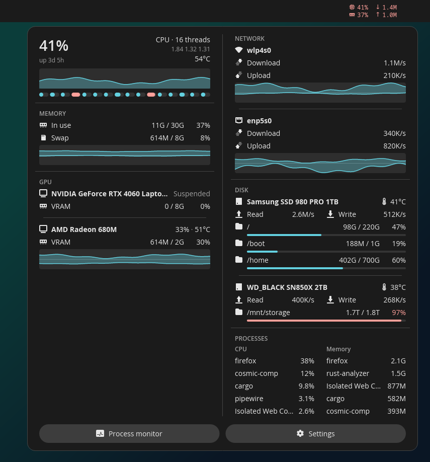

# System monitor applet for the COSMIC™ desktop

A third-party panel applet for the COSMIC™ desktop that shows CPU, memory, GPU, disk and network use at a
glance, with a popup for details, while costing close to nothing when the popup is closed. Its design follows
the Omarchy plugin [navjottomer.sysmon][omarchy-sysmon] (design only; no code is shared). See
[the implementation plan](docs/implementation-plan.md) and the [decision records](docs/adr/).



## Features

- **Panel button:** one or two rows (CPU, RAM, GPU, Disk or CPU °C) with download and upload rates, in the
  Stacked, One line or Compact layout. Vertical panels use Compact.
- **Warnings:** a row turns red when its value crosses a limit (85 °C and 90 % by default). A problem that
  isn't on the panel button, such as a full filesystem or a hot NVMe drive, turns the whole button red. The
  tooltip lists what's wrong.
- **Popup:** total and per-core CPU load, uptime, load average and temperature; memory and swap; every GPU
  with load, temperature, power and VRAM; each network interface; disk throughput, every mounted
  filesystem and NVMe temperatures; the top 5 processes by CPU and by memory. CPU, GPU and network have
  2-minute graphs.
- **Settings page** in the popup. Changes apply at once and are kept.
- **Right click** on the panel button, or **Process monitor** in the popup, opens COSMIC's System Monitor.

## How it stays cheap

- A sampler thread reads `/proc` and `/sys` through files it keeps open, every 2 s (4 s on battery while
  the popup is closed). Processes are only scanned while the popup is open.
- While the popup is closed, the panel button is redrawn only when a shown value moves enough (2 points,
  1 °C, or 1.5× for a network rate), when a warning changes, or after 30 s.
- **A suspended GPU is never woken.** The applet reads only a card's `power/runtime_status` until it is
  awake. NVIDIA stats come from NVML, which is started and shut down per sample, only while the card is
  already awake, and only once every 15 s after the card has gone idle, so it can suspend again
  ([ADR 0003](docs/adr/0003-nvml-per-sample-with-idle-backoff.md)). A suspended card shows its cached
  VRAM size.
- In the Flatpak, a small read-only program on the host, the **probe**, supplies what the sandbox can't see:
  the process table, host mounts and NVML. It starts once and sleeps on its input between requests
  ([ADR 0001](docs/adr/0001-host-probe-over-per-poll-spawn.md)).

### Measured cost

Installed Flatpak in the panel, on battery, default settings (CPU and RAM rows, network rates on), normal
light desktop use, on the reference laptop (16 threads, AMD iGPU and NVIDIA RTX 4060 Laptop GPU in
runtime D3). Measured with `just measure` (`tools/measure.py`), which reads CPU time from
`/proc/<pid>/stat` and counts each thread's context switches as a stand-in for powertop's wakeups.

| | CPU (% of one core) | Wakeups/s | NVIDIA card |
|---|---|---|---|
| Popup closed, 10 min | 0.035 % | 1.6 | `suspended` throughout |
| Popup open, 5 min, no input | 1.1 % | 24 | `suspended` throughout |
| Probe, popup closed | 0.000 % | 0.03 | |
| Probe, popup open | 0.57 % | 1.0 | |

Memory: 28 MB RSS for the applet and 2.8 MB for the probe. For comparison, on the same machine COSMIC's own
`cosmic-applet-power` measured 0.59 wakeups/s and `cosmic-applet-battery` 8.9/s with the same method. Most
of an open popup's cost is in libcosmic's software renderer
([ADR 0004](docs/adr/0004-keep-tiny-skia.md)).

## Requirements

- COSMIC, as a panel applet.
- For the Flatpak's process list, host mounts and NVIDIA stats: host glibc 2.34 or newer (Ubuntu 22.04,
  Debian 12, Fedora 35 or later). Without it the applet still runs, without those
  ([ADR 0002](docs/adr/0002-dynamic-glibc-probe.md)).
- NVIDIA stats need the proprietary driver's `libnvidia-ml.so.1` on the host.

## Install

The applet isn't published yet, so build the Flatpak locally. You need `flatpak`, [just][just], and:

```sh
flatpak install --user flathub org.flatpak.Builder \
    org.freedesktop.Sdk//25.08 org.freedesktop.Sdk.Extension.rust-stable//25.08 \
    com.system76.Cosmic.BaseApp//stable
```

Then, from this repository:

```sh
just flatpak-build     # builds into build-flatpak/repo (offline, from flatpak/cargo-sources.json)
just flatpak-install   # adds build-flatpak/repo as the `sysmon-applet-local` remote and installs from it
```

Open **Settings → Desktop → Panel → Configure panel applets**, press **Add applet** and choose
**System Monitor**.

## Development

A [justfile](./justfile) is included for the [casey/just][just] command runner.

- `just run` builds and runs the applet outside the panel
- `cargo test --workspace` runs the unit tests
- `just measure [PID] [SECONDS]` measures a running applet's CPU time and wakeups
- `just screenshots` regenerates `resources/screenshots/` from a debug-only preview window
- `just check --all-targets` runs clippy with pedantic lints; CI also runs `cargo fmt --check` and denies warnings
- `just flatpak-build` builds the working tree as a Flatpak; builder state stays in `.flatpak-builder/` and
  `build-flatpak/`, since `org.flatpak.Builder` has a private `/tmp`
- `just flatpak-sources` regenerates `flatpak/cargo-sources.json`; run it whenever `Cargo.lock` changes
- `just install` installs a host build under `/usr` (`rootdir=` and `prefix=` change where)

Developers should install [rustup][rustup] and configure their editor to use [rust-analyzer][rust-analyzer].

## Translators

[Fluent][fluent] is used for localization of the software. Fluent's translation files are found in the [i18n directory](./i18n). New translations may copy the [English (en) localization](./i18n/en) of the project, rename `en` to the desired [ISO 639-1 language code][iso-codes], and then translations can be provided for each [message identifier][fluent-guide]. If no translation is necessary, the message may be omitted.

## Licence

MPL-2.0.

[fluent]: https://projectfluent.org/
[fluent-guide]: https://projectfluent.org/fluent/guide/hello.html
[iso-codes]: https://en.wikipedia.org/wiki/List_of_ISO_639-1_codes
[just]: https://github.com/casey/just
[rustup]: https://rustup.rs/
[rust-analyzer]: https://rust-analyzer.github.io/
[omarchy-sysmon]: https://github.com/navjottomer/omarchy-sysmon
